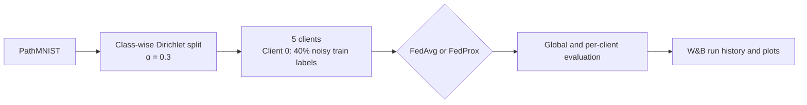
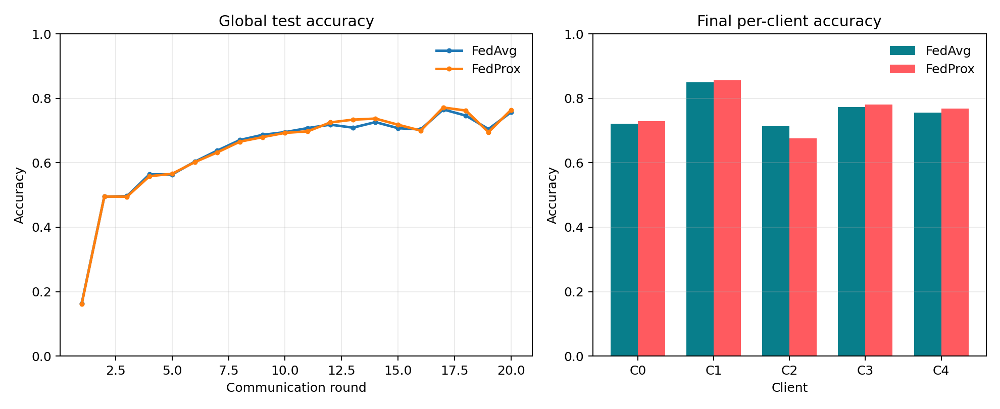

<div align="center">

<h1>Federated Learning on PathMNIST</h1>
<p><strong>FedAvg and FedProx under non-IID data and client label noise</strong></p>

<a href="https://forge.coreweave.com/wandb/ankitdubey7949-indian-institute-of-technology-kanpur/federated-pathmnist"></a>


[Experiment dashboard](https://forge.coreweave.com/wandb/ankitdubey7949-indian-institute-of-technology-kanpur/federated-pathmnist) · [FedAvg run](https://forge.coreweave.com/wandb/ankitdubey7949-indian-institute-of-technology-kanpur/federated-pathmnist/runs/u5hlakuu) · [FedProx run](https://forge.coreweave.com/wandb/ankitdubey7949-indian-institute-of-technology-kanpur/federated-pathmnist/runs/48285hsv)

</div>

This project compares **FedAvg** and **FedProx** on the 9-class PathMNIST image-classification benchmark. Five clients receive non-IID data using a class-wise Dirichlet split (`α = 0.3`); client 0 has 40% symmetric label noise in its training labels. Evaluation labels remain clean.

## Experiment at a glance

| Setting | Value |
|:--|:--|
| Dataset | PathMNIST from MedMNIST, 28 × 28 RGB images, 9 classes |
| Clients | 5; all participate in each communication round |
| Data split | Class-wise Dirichlet allocation, `α = 0.3` |
| Label noise | 40% of client 0's training labels changed to a uniformly sampled incorrect class |
| Algorithms | FedAvg and FedProx (`μ = 0.01`) |
| Training | 20 rounds, 1 local epoch, batch size 128, SGD, learning rate 0.01 |
| Evaluation | Full official test set globally; clean, disjoint non-IID test subsets per client |



## Results

Both seed-0 runs completed for 20 rounds on CPU. FedProx finished **0.72 percentage points higher in global test accuracy** in this run. Client-level results are mixed: FedProx improved most clients, while client 2 scored lower. These are single-seed results, not evidence of statistical significance.

| Method | Seed | Global test accuracy | Global test loss | Run history |
|:--|--:|--:|--:|:--|
| FedAvg | 0 | **75.70%** | 0.9681 | [fedavg_seed0](https://forge.coreweave.com/wandb/ankitdubey7949-indian-institute-of-technology-kanpur/federated-pathmnist/runs/u5hlakuu) |
| FedProx (`μ = 0.01`) | 0 | **76.42%** | 0.9485 | [fedprox_mu0.01_seed0](https://forge.coreweave.com/wandb/ankitdubey7949-indian-institute-of-technology-kanpur/federated-pathmnist/runs/48285hsv) |

| Client | Clean test samples | FedAvg accuracy | FedAvg loss | FedProx accuracy | FedProx loss |
|--:|--:|--:|--:|--:|--:|
| 0 · noisy training labels | 1,020 | 72.06% | 1.0804 | 72.84% | 1.0586 |
| 1 | 460 | 85.00% | 0.6064 | 85.65% | 0.5999 |
| 2 | 516 | 71.32% | 1.0808 | 67.64% | 1.1189 |
| 3 | 1,291 | 77.23% | 0.7454 | 78.16% | 0.7414 |
| 4 | 3,893 | 75.62% | 1.0404 | 76.86% | 1.0069 |

<p align="center">
  
</p>
<p align="center"><em>Global accuracy through training (left) and final per-client accuracy (right).</em></p>

The [final metrics CSV](deliverables/final_metrics.csv) contains the values shown above. The public W&B runs contain the full per-round history.

## What is logged each round?

- Global test accuracy and loss, plus weighted mean local training loss.
- Per-client clean test accuracy and loss, plus each client's training loss.
- Each client's model-update L2 norm.
- Each client's mean cosine similarity to peer updates and the mean pairwise cosine across clients. These cosine values compare client update vectors within the same round.

The project is public and both runs are in the same W&B project: [open the dashboard](https://forge.coreweave.com/wandb/ankitdubey7949-indian-institute-of-technology-kanpur/federated-pathmnist). Do not put API keys or credentials in the repository.

## Run it yourself

Python 3.10 or newer is recommended. The first run downloads PathMNIST into `data/`.

```powershell
python -m venv .venv
.venv\Scripts\Activate.ps1
python -m pip install -r requirements.txt
wandb login
```

Run the two baselines in the same W&B project:

```powershell
python -m src.fedpathmnist.train --algorithm fedavg --seed 0 --wandb-project federated-pathmnist
python -m src.fedpathmnist.train --algorithm fedprox --mu 0.01 --seed 0 --wandb-project federated-pathmnist
```

The script defaults to 20 rounds, five clients, `α = 0.3`, 40% label noise on client 0, one local epoch, and batch size 128. It selects CUDA, Apple MPS, or CPU automatically; pass `--device cpu` to force CPU. Use `--wandb-mode disabled` to run without W&B. Add `--rounds 2` for a quick pipeline check. Change `--seed` to run another seed.

Local CSVs, JSON summaries, accuracy plots, and model checkpoints are written under `outputs/<run-name>/`. Generated data and run outputs are excluded from Git; the W&B project provides the submitted round-by-round logs.

## Implementation notes

- This is a compact, standalone implementation of the requested baselines, rather than a PFLlib fork. The README documents the PathMNIST loader, Dirichlet partitioning, noisy-client labels, clean evaluation, update diagnostics, and output logging added for the task.
- FedAvg aggregates client model parameters weighted by each client's training-set size.
- FedProx adds the proximal penalty `μ / 2 · ||w_client − w_global||²` to the local classification loss.
- Both algorithms use the same CNN: three convolution layers (32/64/128 channels), adaptive average pooling, and a 9-class linear head. The optimizer is SGD with momentum 0.9 and weight decay 0.0001.
- This is a simulation: clients run sequentially in one process; no data is sent over a network. It is not a deployed or privacy-preserving clinical system. MedMNIST is an educational benchmark and is not intended for clinical use.

## Submission materials

- [One-page Reactive Optimizers summary (PDF)](deliverables/reactive_optimizers_summary.pdf) · [Markdown source](deliverables/reactive_optimizers_summary.md)
- [Project presentation (PowerPoint)](deliverables/federated_pathmnist_project.pptx)
- [Final metrics (CSV)](deliverables/final_metrics.csv)
- [Global and per-client accuracy plot (PNG)](deliverables/global_accuracy_comparison.png)

## References

- [PathMNIST / MedMNIST](https://github.com/MedMNIST/MedMNIST)
- [PFLlib](https://github.com/TsingZ0/PFLlib)
- [Reactive Optimizers post](https://xingjianbai.com/reactive-optimizers/)
